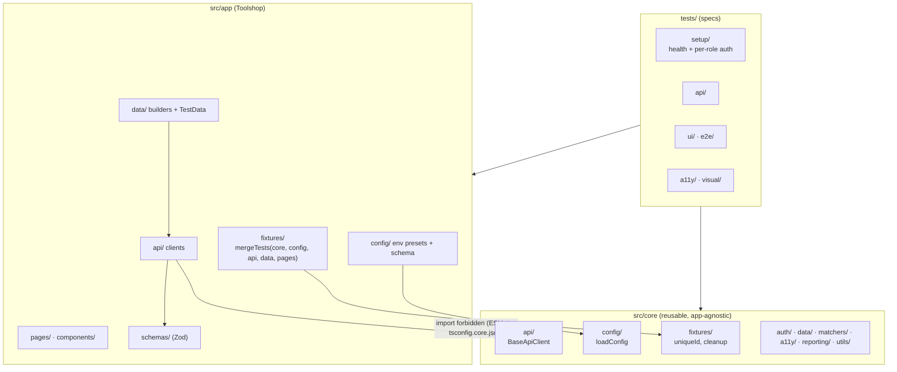
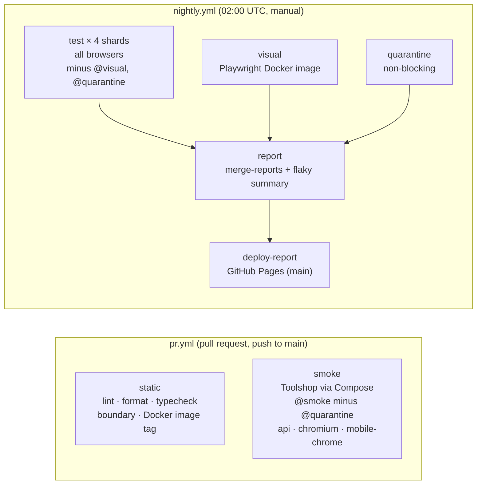

# Architecture

This framework tests [Practice Software Testing (Toolshop)](https://practicesoftwaretesting.com)
and is meant to be reused for other applications. Everything below follows from one rule: code
that knows about Toolshop lives in `src/app` and `tests`, and the reusable framework lives in
`src/core`.



## The core/app boundary

| Layer      | Contains                                                                                                                        | May import            |
| ---------- | ------------------------------------------------------------------------------------------------------------------------------- | --------------------- |
| `src/core` | Config loader, base API client, `toMatchSchema`, cleanup queue, storage-state helpers, factory helper, axe scan, flaky reporter | Playwright, Zod, Node |
| `src/app`  | Toolshop config, page objects, components, API clients, schemas, builders, fixtures, a11y baseline                              | `src/core`            |
| `tests`    | Specs and setup projects                                                                                                        | `src/app`, `src/core` |

Three checks enforce it, and all run in the PR workflow:

- `import-x/no-restricted-paths` fails lint for any relative import from `src/app` or `tests`
  inside `src/core`.
- A `no-restricted-imports` pattern does the same for the `@app/*` alias.
- `tsconfig.core.json` type-checks `src/core` with only the `@core/*` alias defined, so an import
  that slipped past lint still fails `npm run typecheck:core`.

`src/core` was also checked by copying the repository without `src/app` and `tests` and running
`tsc -p tsconfig.core.json` and ESLint on it: both pass.

The core is deliberately small. It holds only what a second application would need unchanged,
and nothing that Playwright already provides.

## Fixture composition

There are no base test classes. Every spec imports `test` and `expect` from `@app/fixtures`,
which is built with `test.extend` and `mergeTests`:

```
@core/fixtures   uniqueId, cleanup                           (test scope)
configTest       config: validated ToolshopConfig            (worker scope)
apiTest          apiRequest, api, customerApi, adminApi,     (extends configTest)
                 apiWithToken(token)
dataTest         testData: create via API, delete after test (extends apiTest)
pagesTest        one fixture per page object
test = mergeTests(coreTest, configTest, apiTest, dataTest, pagesTest)
```

- A test asks only for what it uses: `async ({ cartPage, testData }) => …`. Fixtures that are not
  requested are never created.
- Fixture dependencies order teardown. `testData` depends on the API clients, so they are still
  alive when it deletes the test's data, even after a failure.
- Customer and admin API tokens are fetched per test rather than per worker, because Toolshop JWTs
  expire after five minutes.
- `config` is worker-scoped. It is parsed once at import time by `loadConfig`, which fails before
  any browser starts if a variable is missing or invalid.

## Auth strategy

1. The **`health`** project checks that the API (`/status`) and UI respond, with a message
   pointing at `npm run toolshop:start` when they do not.
2. The **`setup`** project logs in each role (`customer`, `admin`) **through the API** and writes
   the JWT into a storage state (`.auth/<role>.json`) the way the Angular app stores it in
   `localStorage`. No browser is involved, so this takes milliseconds.
3. Specs opt into a role with `test.use({ storageState: authFile('customer') })`. Guests need
   nothing.
4. Users created by a test (for example the checkout customer) are signed in with
   `signInWithToken(context, token)`, an init script that sets the same `localStorage` key.

The login UI is still covered by `tests/ui/auth/login.spec.ts`. See
[ADR 0002](decisions/0002-api-based-auth-setup.md).

## Data strategy

- **Builders** (`src/app/data/builders.ts`) return valid payloads from Faker. Names carry a unique
  suffix so parallel tests never collide on unique columns. Overrides set only what a test cares
  about: `buildProduct({ stock: 0 })`.
- **`testData`** creates entities through the API (`testData.product()`, `testData.customer()`)
  and registers their deletion on a LIFO cleanup queue. The queue runs after the test whether it
  passed or failed.
- **Responses are parsed through Zod schemas.** Types are inferred with `z.infer`, so there is one
  source of truth, and `expect(response).toMatchSchema(schema)` asserts contracts in API tests.
- **Data Toolshop cannot delete** is kept and recorded as a `retained-data` annotation, rather than
  failing the test. This covers customers or products referenced by an order, and contact
  messages.
- **Every run starts from a fresh database.** CI starts each run with
  `php artisan migrate:fresh --seed`; locally, run `npm run toolshop:seed`.
- **Tests never depend on another test's data.** The suite runs with `fullyParallel: true`.

## Test layers and projects

| Project                                          | Runs                        | Notes                                                     |
| ------------------------------------------------ | --------------------------- | --------------------------------------------------------- |
| `health`                                         | API/UI reachability         | Dependency of everything                                  |
| `setup`                                          | Per-role storage states     | Depends on `health`                                       |
| `api`                                            | `tests/api`                 | No browser                                                |
| `chromium`, `firefox`, `webkit`, `mobile-chrome` | `tests/ui`, `tests/e2e`     | Same specs on every browser                               |
| `a11y`                                           | `tests/a11y`                | Desktop Chromium only; axe scans and ARIA snapshots       |
| `visual`                                         | `tests/visual`              | Skipped outside the Playwright Docker image               |
| `agents`                                         | `tests/agents/seed.spec.ts` | Exists only with `PW_AGENTS=1`, for the Playwright agents |

Tags select runs across projects. They are `@smoke`, `@regression`, `@api`, `@a11y`, `@visual`
and `@quarantine`, used through `npm run test:<tag>`.

## CI flow



Every job that runs tests follows the same steps:

1. Start Toolshop from `docker-compose.yml` using the `start-toolshop` composite action, and wait
   for all services to be healthy.
2. Seed the database.
3. Run the tests.
4. Upload the report, plus traces on failure.
5. Tear the stack down.

Supporting details:

- npm packages and Playwright browsers are cached.
- Third-party actions are pinned to commit SHAs.
- A newer run on the same ref cancels the older one.
- Retries (2) are enabled only in CI, with `trace: 'on-first-retry'`, so any retried failure
  comes with a trace.

## Reporting

- **HTML report:** always written. In CI it is also written as blob reports, which the nightly
  merges into one HTML report and publishes to GitHub Pages.
- **Flaky summary** (`src/core/reporting`): after each run it lists the tests that passed only on
  retry and every `@quarantine` test. It writes to the console and the GitHub job summary. See
  [flaky-tests.md](flaky-tests.md).
- **Allure:** opt-in with `ALLURE=1`, so everyday runs stay unchanged.

## Further reading

- [Adapting to your app](adapting-to-your-app.md)
- [Flaky tests](flaky-tests.md)
- [AI-assisted testing](ai-assisted-testing.md)
- [Decisions (ADRs)](decisions/)
